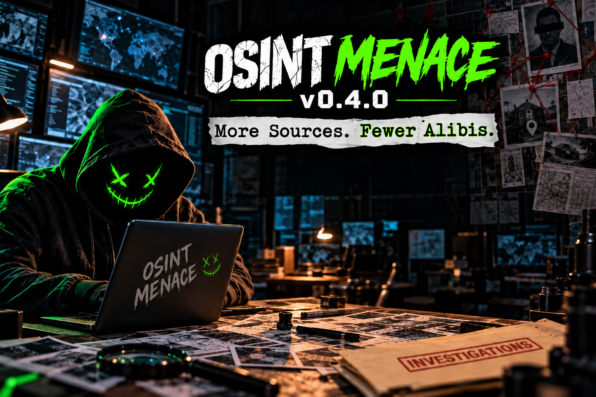

# OSINT Menace

**v0.4.0 — More Sources. Fewer Alibis.**



A local investigation workspace from Defensive Thinking. Search public sources, review findings, retain evidence, build case graphs, and export reports.

Start with the [Quickstart and tool/API guide](docs/QUICKSTART.md) for installation, a first investigation, and credential requirements.

## New in v0.4.0

- **Seven new integrations:** Unfurl, waymore, Subfinder, dnstwist, theHarvester, ExifTool, and Mail-Parser.
- **Research and evidence:** web/news search, telephone and address research, original email analysis, retained PDF/image reading, and metadata inspection.
- **Case workflows:** cross-case comparisons, investigation questions, source monitoring, reusable workflows, review inboxes, dashboards, and improved reporting.
- **Easier setup:** one `install.py` entry point, an organized source tree, verified backups, and data-preserving updates.
- **New quickstart guide:** first investigation walkthrough, tool descriptions, API/session requirements, and credential setup.

See the [v0.4.0 release notes](docs/releases/v0.4.0.md) or the [full feature overview](docs/OVERVIEW.md).

## Install or upgrade

Start Docker Desktop or Docker Engine with Compose v2, then run from this project folder:

```sh
python3 install.py
```

The installer fetches pinned tools, builds Docker, backs up existing data, and checks the running application. Open [http://localhost:8088](http://localhost:8088). Use `python3 install.py --no-open` to skip browser launch.

```sh
python3 install.py --help
python3 install.py --check
python3 install.py --update
```

The Python entry point uses only the standard library. macOS, Linux, and WSL2 need Bash and Docker/Compose; no host addon packages are required. A Bash-only alternative is `bash deployment/install.sh`.

## Project folders

| Location | Contents |
| --- | --- |
| `install.py` | Main installer and updater entry point |
| `osint/` | Application modules, templates, static assets, workers, pinned addon manifest, and version |
| `deployment/` | Dockerfile, Compose configuration, startup, setup, and update helpers |
| `requirements/` | Application, workspace, discovery, and development dependencies |
| `docs/` | Feature guides, installation instructions, release notes, and images |
| `tests/` | Focused automated checks and fixtures |
| `config/` | Development tool configuration |
| `data/` | Existing investigation data and local configuration; preserved in place |
| `output/`, `tmp/` | Local generated artifacts and temporary files |

See [Project layout](docs/PROJECT_LAYOUT.md), [Installation](docs/INSTALL.md), [Features](docs/OVERVIEW.md), [Terminal guide](docs/CLI.md), and [Release notes](docs/CHANGELOG.md).

Run Docker commands from the project folder with `docker compose -f deployment/docker-compose.yml …`. The application has no built-in login; use the web interface on a trusted local network.

Created by **Alex Berta · Defensive Thinking**. Licensed under [Apache License 2.0](LICENSE); integrated tools retain their own licenses.
