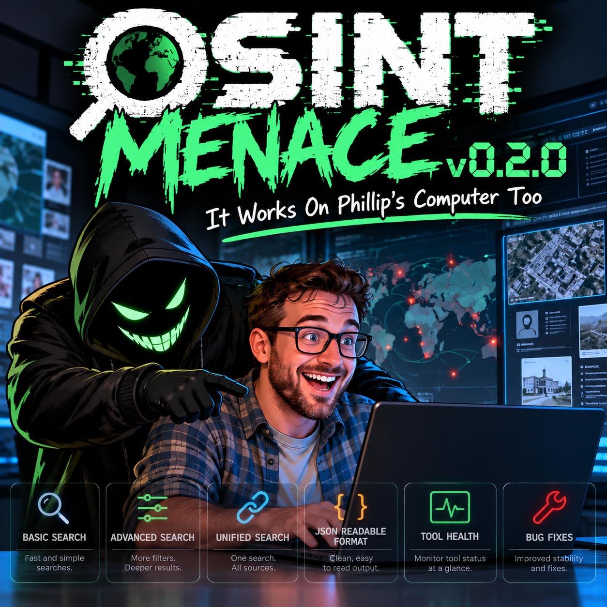

# OSINT Menace

**v0.2.0 — It Works on Phillip’s Computer Too**



**Open-Source Recon Console · Built for Hunters, Not Browsers.**
A Defensive Thinking Project by Alex Berta.

OSINT Menace is a local investigation workspace with a Dockerized web interface and a terminal interface. Run public-source searches, review unverified leads, save useful findings to cases, attach evidence, and export reports.

[Quick start](#quick-start) · [Features](#features) · [Included addons](#included-addons) · [CLI guide](CLI.md) · [Changelog](CHANGELOG.md)

## Features

- **Console:** searches for emails, usernames, phone numbers, names, domains, IP addresses, and crypto wallets, including mixed-input detection.
- **Addons and Unified Search:** twelve isolated tools, compatible multi-tool searches, cancellation, execution states, elapsed time, and observed rate limits.
- **Readable results:** structured JSON presented as facts, cards, and tables, with raw output available for inspection.
- **History and tool health:** reopen saved web searches without rerunning them; inspect installation, local startup checks, and observed execution outcomes.
- **Case workspaces:** analyst notes, per-finding verification states, report selection, activity timelines, and reversible duplicate consolidation that retains original findings and source assessments.
- **Evidence provenance:** screenshot attachments, source URLs, attachment times, optional capture times, SHA-256 hashes, and file-integrity checks.
- **Dossiers and reports:** guided dossier editing, editable Word reports, PDF reports, and JSON/Markdown/HTML exports. Report capabilities differ by interface; see the guides below.
- **Backup and restore:** complete case ZIPs with referenced evidence and a file manifest; verified import previews restore into a separate case without overwriting existing work.
- **Terminal workspace:** interactive searches, batch input, direct public-source collectors, case management, reviews/tags, dossier editing, and standalone report exports.
- **Fictional demo:** explore a read-only sample case at `/demo` without running network searches.

Image analysis and image searching are currently **disabled and deferred**.

## Quick start

### Docker web interface

Requirements: Docker Desktop or Docker Engine with Compose v2, Git, and Python 3.12+ to fetch the pinned addon sources.

```bash
git clone https://github.com/awesom3alex/osint-menace.git
cd osint-menace
python3 addons/fetch.py
docker compose up -d --build
```

Open **[http://localhost:8088](http://localhost:8088)**.

The first build downloads tool dependencies and can take several minutes. Each Python addon uses its own virtual environment; Go tools are compiled from pinned sources. The running image is `osint-menace:0.2.0`.

```bash
# Check the running version
curl http://localhost:8088/api/version

# Stop the web app; saved data remains in ./data
docker compose down
```

Compose listens on all host interfaces at port 8088, allowing access from another computer on a trusted local network using the host’s LAN address. **There is no built-in authentication. Do not publish this port directly to the internet.**

See [INSTALL.md](INSTALL.md) for setup, troubleshooting, updates, and local development.

### Terminal interface

```bash
python3 -m venv .venv
source .venv/bin/activate
pip install -r requirements.txt -r requirements-workspace.txt
python menace.py --version
python menace.py
```

Examples:

```bash
python menace.py search exampleuser --type username
python menace.py search example.com --type domain --json
python menace.py create "Investigation One"
python menace.py cases
python menace.py export demo --format docx --output demo.docx
```

The terminal supports direct GitHub, Bluesky, GitLab, and Hacker News profile checks; phone numbering metadata; bounded Bitcoin/Ethereum summaries; public-page capture; record-source connectors; and candidate-link generation. Candidate links are not confirmation that an account exists or belongs to a particular person.

See [CLI.md](CLI.md) for commands, provider coverage, limits, and credentials. Web addon scheduling and the web History database are separate from the terminal result workspace.

## Included addons

Tools run only when explicitly selected. Outputs are leads to review, not identity or account-ownership proof.

| Menace tool | Upstream project | Input / purpose |
| --- | --- | --- |
| Basic Search | [Sherlock](https://github.com/sherlock-project/sherlock) | Username profile checks |
| Advanced Search | [Maigret](https://github.com/soxoj/maigret) | Broader username searches |
| WhatsMyName Search | [Naminter](https://github.com/3xp0rt/naminter) | Username searches using WhatsMyName data |
| Social Profile Analysis | [Social Analyzer](https://github.com/qeeqbox/social-analyzer) | Public-profile searches and analysis |
| Platform Scanner | [Aliens’ Eye](https://github.com/arxhr007/Aliens_eye) | Username matches |
| Instagram Intel | [Toutatis](https://github.com/megadose/toutatis) | Instagram details; requires `INSTAGRAM_SESSION_ID` |
| Account Availability | [Socialscan](https://github.com/iojw/socialscan) | Username/email availability checks |
| Account Search | [Blackbird](https://github.com/p1ngul1n0/blackbird) | Username/email searches |
| Email Accounts | [Holehe](https://github.com/megadose/holehe) | Supported-service email registration checks |
| Phone Intelligence | [PhoneInfoga](https://github.com/sundowndev/phoneinfoga) | Phone intelligence; some scanners need provider keys |
| Phone Account Check | [Ignorant](https://github.com/megadose/ignorant) | Supported-service registration checks; separate calling code |
| Phone Enrichment | [Clank](https://github.com/AnshumanAtrey/clank) | Local numbering, carrier-of-record, and region metadata |

See [addons/README.md](addons/README.md) for installation details, pinned revisions, source licenses, and limits. Many tools need no paid API key for their standard operation, but services can block, change, or rate-limit results. Toutatis needs a server-side session; SEC and CourtListener terminal connectors need their own configuration. Never commit credentials to Git.

## Typical investigation

1. Create a case and record the investigation’s scope and authorization.
2. Run a Console search or select compatible tools in Addons/Unified Search.
3. Review the findings and sources, then save useful observations to the case.
4. Add verification notes and evidence. Review duplicate candidates before merging them.
5. Select findings for reports, export the desired format, and download a case backup ZIP.

The interface keeps case saves in place so you can continue working. Cancellation stops unfinished addon work and retains available output, but cannot undo requests already sent to an external service.

## Backup preview

The example below uses synthetic data.


From a case, choose **Download backup ZIP**. On the Cases page, choose **Restore a case backup**, inspect the verified preview, and restore as a new case.

Case backups include notes, saved findings, reviews, timeline, duplicate groups, provenance, referenced evidence, and a Markdown report snapshot. Independent global History, server credentials, and deferred image-analysis originals are not included. Other reports can be regenerated after restore. Backups are not encrypted.

## Data and privacy

| Location | Contents |
| --- | --- |
| `data/cases/` | Case JSON, dossiers, reviews, notes, timeline, and merge records |
| `data/evidence/` | Case screenshot attachments |
| `data/workspace.sqlite3` | Web search History and observed tool health |
| `data/cli_state.json` | Terminal workspace state |
| `data/pending_backups/` | Temporary import previews, expiring after one hour |
| `exports/` | Default terminal report exports |

Runtime investigation data, credentials, downloaded addon source trees, and temporary artifacts are excluded from Git. Docker persists the host’s `./data` directory. For a full application backup including History, stop the service and back up that directory consistently.

Selected tools and collectors contact their upstream services with the supplied target. Case evidence uploads are stored locally; Menace does not submit uploaded photos to image-search providers. Do not place sensitive investigation details in public issues, screenshots, or sample data.

## Limits and operating scope

- Generated URLs, tool matches, availability responses, and registration checks require independent verification.
- Phone region/carrier output describes numbering metadata, not ownership or live location.
- Network services can return partial results, false positives, errors, or rate limits. A successful process exit does not establish complete coverage.
- Web addon execution uses two workers, bounded queues, and time/output limits. Keep the single Gunicorn process configuration unless the scheduler and file locking are redesigned for multiple processes.
- Evidence hashes verify byte consistency; they do not prove that a source or screenshot is authentic. Legacy attachments may not have a historical hash.
- This is an early local-network research application. Use only for lawful, authorized work, and respect service terms and access controls.

Detailed limits and persistence behavior: [WORKSPACE_FEATURES.md](WORKSPACE_FEATURES.md).

## Development and contributions

```bash
pip install -r requirements-dev.txt
ruff check .

docker compose exec -T menace python -m unittest discover -s tests -v
docker compose exec -T menace python addons/check.py
```

Addon startup checks run local `--help` commands rather than querying public targets. Automated tests use temporary data and fixtures; the image-feature tests remain skipped while those features are disabled.

Report bugs or suggest improvements through [GitHub Issues](https://github.com/awesom3alex/osint-menace/issues). Include the version, reproduction steps, and redacted error output. Contributions should preserve source attribution, readable results, bounded execution, cancellation, and case/report compatibility.

## License and credits

OSINT Menace is licensed under [Apache License 2.0](LICENSE). Integrated tools and dependencies retain their own licenses. Pinned upstream sources and their licenses are fetched separately rather than vendored into this repository. Review those licenses before redistributing a combined build. Test fixtures have source notes in [tests/fixtures/README.md](tests/fixtures/README.md).

Created by **Alex Berta · Defensive Thinking**.

- Contact: Alex@DefensiveThinking.org
- LinkedIn: [AlexanderBerta](https://www.linkedin.com/in/AlexanderBerta/)
- Support: [Buy Me a Coffee](https://buymeacoffee.com/alexberta)

Documentation: [Installation](INSTALL.md) · [Terminal guide](CLI.md) · [Workspace details](WORKSPACE_FEATURES.md) · [Addon details](addons/README.md) · [Release notes](CHANGELOG.md)
